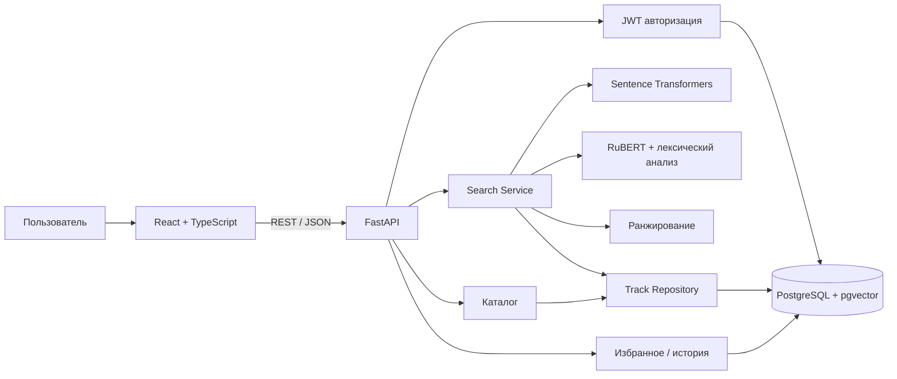

# Melodia

Интеллектуальный сервис поиска музыкальных композиций по текстовому описанию и эмоциональным характеристикам.

Пользователь описывает желаемую музыку обычным текстом. Backend создаёт embedding запроса, находит близкие описания в PostgreSQL/pgvector и повторно ранжирует композиции по эмоциям и жанру. В интерфейсе доступны каталог, регистрация, избранное и история запросов.

## Что реализовано

- React + TypeScript интерфейс: поиск, подсказки запросов, фильтр жанра, каталог, избранное, история и окно авторизации.
- FastAPI API: поиск, каталог, регистрация, вход по JWT, профиль, избранное и история.
- PostgreSQL модели для пользователей, композиций, избранного и истории; Alembic миграции и расширение pgvector.
- Семантические embeddings модели `sentence-transformers/paraphrase-multilingual-MiniLM-L12-v2` (384 измерения).
- Русский анализ эмоций через multi-label модель RuBERT; лексический классификатор дополняет отсутствующие у модели категории `calm` и `romance`.
- Резервный текстовый поиск, когда embedding-модель не загрузилась. Интерфейс явно показывает этот режим.
- Каталог изначально пустой: проект не содержит синтетических музыкальных записей. Композиции загружаются из подготовленного пользователем CSV-файла.

## Архитектура

Приложение реализовано как модульный монолит: frontend отделён от REST API, а каталог, поиск, ML-обработка и пользовательские функции разделены внутри backend на модули.



Схемы последовательности, данных и описание алгоритма приведены в [docs/architecture.md](docs/architecture.md). План курсовой, адаптированный к чек-листу методички, находится в [docs/coursework-outline.md](docs/coursework-outline.md).

## Запуск через Docker Compose

Нужны Docker Desktop с Compose и подключение к Hugging Face при первом поиске, чтобы загрузить веса моделей. После загрузки они сохраняются в Docker volume.

В PowerShell из корня репозитория:

```powershell
Copy-Item .env.example .env
```

Перед публикацией нужно заменить `JWT_SECRET_KEY` в `.env` на случайный секрет. Затем:

```powershell
docker compose up --build
```

Адреса после запуска:

- приложение: `http://localhost:5173`
- REST API: `http://localhost:8000`
- интерактивная документация API: `http://localhost:8000/docs`

При первом поиске загружаются веса embedding- и emotion-моделей. Если загрузка недоступна, API продолжит работу с резервным поиском по словам; после восстановления доступа к Hugging Face перезапустите backend, чтобы повторить загрузку.

Для остановки используется `Ctrl+C`, для остановки контейнеров — `docker compose down`. Каталог и скачанные модели сохраняются в именованных volumes. Удаление volumes удалит и сохранённые данные.

## Локальный запуск без контейнеров

1. Запустить PostgreSQL с pgvector: `docker compose up -d db`.
2. В `backend` создать виртуальное окружение Python 3.11+ и установить `python -m pip install -e ".[ml]"`.
3. Из папки `backend` выполнить `alembic upgrade head`.
4. Запустить API: `uvicorn app.main:app --reload`.
5. В `frontend` выполнить `npm install` и `npm run dev`.

Для локального запуска backend считывает параметры из `.env` в корне проекта или из переменных среды. Настройки перечислены в [.env.example](.env.example).

## API

| Метод | Путь | Назначение |
|---|---|---|
| `GET` | `/api/health` | Состояние API |
| `POST` | `/api/auth/register` | Регистрация и выдача токена |
| `POST` | `/api/auth/login` | Вход и выдача токена |
| `GET` | `/api/auth/me` | Текущий пользователь |
| `POST` | `/api/search` | Семантический поиск и ранжирование |
| `GET` | `/api/tracks` | Каталог; поддерживает фильтр `genre` |
| `GET` | `/api/tracks/{id}` | Карточка композиции |
| `GET` | `/api/favorites` | Избранное пользователя |
| `POST` | `/api/favorites/{track_id}` | Добавить в избранное |
| `DELETE` | `/api/favorites/{track_id}` | Убрать из избранного |
| `GET` | `/api/history` | История поисковых запросов |

## Загрузка собственного каталога

Каталог при запуске пуст. Заготовка CSV с заголовками столбцов находится в `data/catalog-template.csv`. Заполни её реальными данными или положи свой CSV в папку `data`. Обязательные столбцы: `title`, `artist`, `genre`, `description`. Необязательны `listening_url` и оценки `joy`, `sadness`, `calm`, `energy`, `romance`, `anxiety` от 0 до 1.

При запуске через Docker папка `data` доступна API-контейнеру как `/data`. Импорт из корня репозитория:

```powershell
docker compose exec api python -m app.import_catalog /data/catalog-template.csv
```

При локальном запуске без контейнеров выполни ту же команду из папки `backend`, указав путь `..\data\catalog-template.csv`.

При изменении описания embedding композиции пересоздаётся при следующем поиске. Перед загрузкой аудио и ссылок нужно проверить лицензию и право на распространение; Melodia хранит только предоставленные метаданные и ссылку.

## Оценка качества для курсовой

Для экспериментальной части следует подготовить русскоязычные запросы с оценкой релевантности композиций, сравнить лексический fallback и семантический поиск и исследовать веса ранжирования. Результаты модели RuBERT на её исходном корпусе не являются оценкой качества поиска музыки; метрики необходимо получить на собственном наборе.
