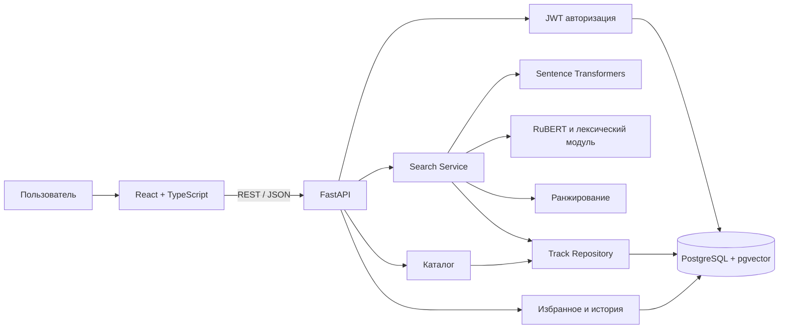
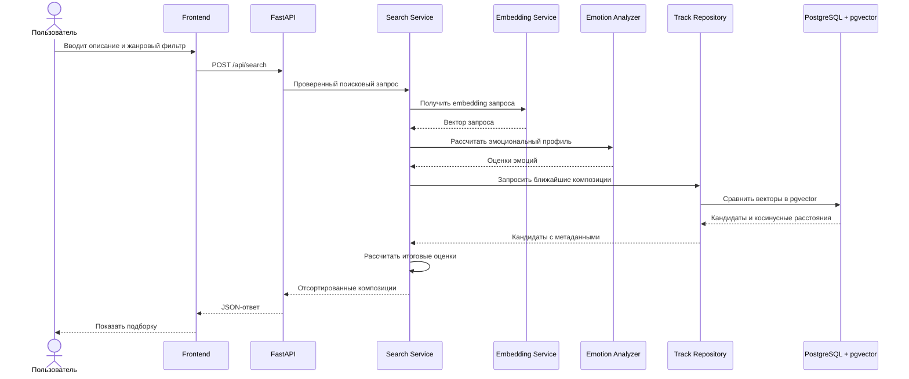
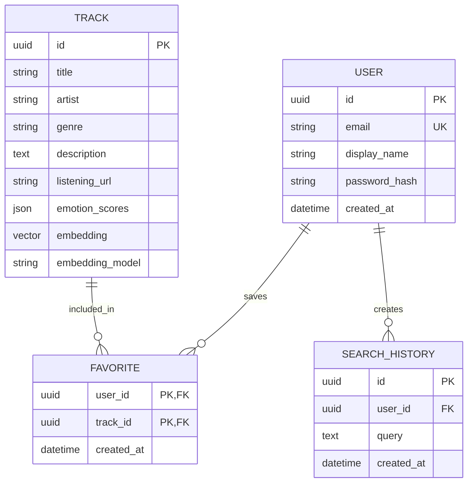

# 3 Проектирование интеллектуального сервиса Moodify

## 3.1 Назначение и границы системы

Moodify предназначен для поиска композиций по текстовому описанию музыкального контекста и желаемого эмоционального состояния. Поисковый сценарий объединяет смысловую близость запроса, оценки эмоций и выбранный жанровый фильтр. Каталог хранит метаданные, текстовые описания, ссылки на легальные источники прослушивания и эмоциональные оценки композиций.

В текущей реализации каталог содержит синтетические примеры. Приложение не размещает аудиофайлы и не выполняет автоматический анализ аудиосигнала. Эмоциональный профиль композиции задаётся при импорте данных; эмоциональный профиль запроса рассчитывается языковым модулем.

## 3.2 Архитектурное решение

Для приложения выбрана архитектура модульного монолита с отдельным web-клиентом. React-интерфейс взаимодействует с REST API. Backend разделён на маршруты, схемы данных, сервисы поиска, ML-модули и репозитории. Такое разбиение сохраняет единый процесс развёртывания и одновременно локализует изменения алгоритмов и хранилища.

Состав компонентов и основные направления их взаимодействия показаны на рисунке 1.

Рисунок 1 — Компонентная схема сервиса Moodify.

Пользовательский интерфейс реализован как набор React-компонентов и обращается к FastAPI по HTTP. FastAPI формирует OpenAPI-описание и интерактивную документацию API [1]. Модуль каталога предоставляет метаданные композиций, а модуль поиска координирует кодирование текста, эмоциональный анализ и ранжирование.

## 3.3 Состав программных модулей

Основные обязанности программных компонентов систематизированы в таблице 1.

Таблица 1 — Программные компоненты и их ответственность.

| Компонент | Ответственность |
|---|---|
| Frontend | Ввод запроса, отображение результатов, каталог, избранное и история |
| API | Проверка входных данных, маршрутизация и формирование ответов |
| Search Service | Координация моделей, извлечение кандидатов и итоговая сортировка |
| Embedding Service | Создание вектора запроса и векторов текстов каталога |
| Emotion Analyzer | Получение многометочных оценок эмоций запроса |
| Ranking Service | Нормализация оценок семантики, эмоций и жанра |
| Track Repository | Чтение каталога и поиск ближайших векторов в PostgreSQL |
| Auth / Favorites / History | Пользовательская сессия, сохранённые композиции и история запросов |

В frontend предусмотрены четыре пользовательских раздела: поиск, каталог, избранное и история. Backend предоставляет маршруты для этих сценариев и Swagger UI для просмотра API.

## 3.4 Последовательность обработки поискового запроса

Порядок работы компонентов при поиске композиции показан на рисунке 2. При первой обработке каталога embedding-модель кодирует описания композиций и сохраняет векторы. При последующих запросах каталоговые векторы повторно используются; кодируется только новый пользовательский запрос.

Рисунок 2 — Последовательность обработки поискового запроса.

Для пользователя без авторизации поиск возвращает результаты без сохранения истории. Для авторизованного пользователя текст запроса добавляется в таблицу истории. Запрос избранного и история защищены bearer-токеном JWT.

## 3.5 Модель данных

Сущности базы данных и связи между ними представлены на рисунке 3. Эмоциональные оценки композиции хранятся в JSON-объекте с фиксированным набором ключей. Векторы хранятся в столбце типа `vector` расширения pgvector вместе с идентификатором модели, создавшей вектор.

Рисунок 3 — Логическая модель данных Moodify.

Расширение pgvector позволяет хранить векторы рядом с реляционными данными и выполнять поиск по косинусному расстоянию; для небольшого учебного каталога применяется точный поиск [2]. Миграция Alembic создаёт таблицы и расширение. При загрузке нового описания его вектор сбрасывается и автоматически пересчитывается при следующем поиске.

## 3.6 Интеллектуальный модуль и ранжирование

Для семантического представления русскоязычного текста используется `sentence-transformers/paraphrase-multilingual-MiniLM-L12-v2`. Карточка модели указывает поддержку 50 языков и вектор размерности 384; модель предназначена для представления предложений и семантического поиска [3]. Модель загружается лениво, работает на CPU, а её веса сохраняются в Docker volume.

Эмоциональный анализ выполняется русскоязычной multi-label моделью `Aniemore/rubert-tiny2-russian-emotion-detection`. Её выходные классы считываются из конфигурации модели; multi-label классификация допускает одновременно несколько эмоций. Проект сопоставляет доступные категории радости, грусти, энергии и тревожности с внутренней шкалой Moodify. Спокойствие и романтика дополняются лексическим анализатором, поскольку они не входят в полный набор меток модели [4]. Поскольку модель обучена на текстовых сообщениях, качество её применения к музыкальным запросам должно быть проверено отдельной выборкой запросов с экспертной разметкой.

Для каждого кандидата определяются следующие оценки:

- (S_t) — нормированная семантическая близость запроса и описания композиции;
- (E_t) — сходство эмоциональных профилей запроса и композиции;
- (G_t) — соответствие выбранному жанру.

Косинусное расстояние pgvector (d_t) преобразуется в оценку диапазона ([0,1]):

\[
S_t = 1 - \frac{d_t}{2}.
\]

Эмоциональная близость вычисляется как единица минус средняя абсолютная разница по шести внутренним эмоциональным категориям:

\[
E_t = 1 - \frac{1}{6}\sum_{j=1}^{6}|p_j-e_{tj}|,
\]

где (p_j) — оценка эмоции (j) в пользовательском запросе, а (e_{tj}) — сохранённая оценка этой эмоции у композиции (t).

Начальные коэффициенты ранжирования составляют 0,5 для семантического сходства, 0,4 для эмоций и 0,1 для жанра. Используются только применимые к запросу признаки; активные веса нормируются к единице. При недоступности embedding-модели сервис сообщает об этом и выполняет лексический поиск по словам.

## 3.7 API и безопасность

Ключевые маршруты системы перечислены в таблице 2. Полный контракт REST API доступен через OpenAPI в `/docs`.

Таблица 2 — Основные маршруты REST API.

| Метод | Маршрут | Назначение |
|---|---|---|
| `POST` | `/api/search` | Поиск и ранжирование композиций |
| `GET` | `/api/tracks` | Каталог и жанровый фильтр |
| `POST` | `/api/auth/register` | Создание аккаунта |
| `POST` | `/api/auth/login` | Вход и выдача JWT |
| `GET` | `/api/auth/me` | Данные текущего пользователя |
| `GET` | `/api/favorites` | Список избранного |
| `POST` / `DELETE` | `/api/favorites/{track_id}` | Добавление или удаление избранного |
| `GET` | `/api/history` | История запросов |

Доступ к сущностям базы данных организован через SQLAlchemy ORM, а изменения схемы фиксируются миграциями Alembic [6], [7]. Пароли сохраняются в виде Argon2-хеша. JWT содержит идентификатор пользователя и время истечения токена. Секрет подписи передаётся переменной окружения `JWT_SECRET_KEY`; демонстрационный секрет из примера предназначен только для локальной разработки. Использование JWT и Argon2 соответствует рекомендуемому для FastAPI сценарию [5].

## 3.8 Источники

1. FastAPI. First Steps: OpenAPI и интерактивная документация [Электронный ресурс]. URL: [https://fastapi.tiangolo.com/tutorial/first-steps/](https://fastapi.tiangolo.com/tutorial/first-steps/) (дата обращения: 14.11.2026).
2. pgvector. README проекта и поиск по векторам [Электронный ресурс]. URL: [https://github.com/pgvector/pgvector](https://github.com/pgvector/pgvector) (дата обращения: 14.11.2026).
3. Sentence Transformers. Карточка многоязычной MiniLM-модели [Электронный ресурс]. URL: [https://huggingface.co/sentence-transformers/paraphrase-multilingual-MiniLM-L12-v2](https://huggingface.co/sentence-transformers/paraphrase-multilingual-MiniLM-L12-v2) (дата обращения: 14.11.2026).
4. Aniemore. Русская multi-label модель определения эмоций [Электронный ресурс]. URL: [https://huggingface.co/Aniemore/rubert-tiny2-russian-emotion-detection](https://huggingface.co/Aniemore/rubert-tiny2-russian-emotion-detection) (дата обращения: 14.11.2026).
5. FastAPI. OAuth2, JWT и хеширование пароля [Электронный ресурс]. URL: [https://fastapi.tiangolo.com/tutorial/security/oauth2-jwt/](https://fastapi.tiangolo.com/tutorial/security/oauth2-jwt/) (дата обращения: 14.11.2026).
6. SQLAlchemy ORM [Электронный ресурс]. URL: [https://docs.sqlalchemy.org/en/20/orm/](https://docs.sqlalchemy.org/en/20/orm/) (дата обращения: 14.11.2026).
7. Alembic — миграции базы данных [Электронный ресурс]. URL: [https://alembic.sqlalchemy.org/en/latest/](https://alembic.sqlalchemy.org/en/latest/) (дата обращения: 14.11.2026).
